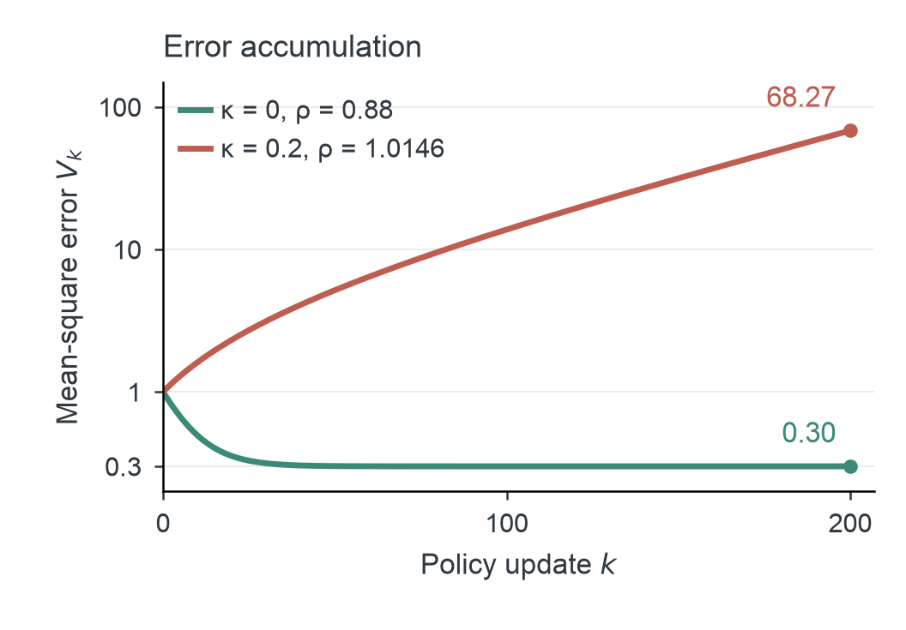

# REINFORCE Zero algorithm

REINFORCE Zero combines trainer–inference invariance (TII), group-mean advantages, and unclipped token-level importance sampling (IS) for asynchronous reinforcement learning. The method and implementation details are described in the [paper](REINFORCE-Zero.pdf).

## Align execution, then correct policy lag

Kernels are the low-level GPU routines behind matrix multiplication, attention, and normalization. Their floating-point results depend on the implementation and on how sequences are batched, so the rollout engine and the learner can assign different probabilities to the same token even at identical weights.

TII requires matching token probabilities in the rollout engine and learner at identical weights and token histories. Batch-invariant kernels (a sequence's output does not depend on the rest of its batch) and matched forward computation (both systems evaluate the same operators with the same kernels) establish this property.

Let $k$ be the current learner update and $v$ the policy version used for a rollout. At a fixed history, let $\pi_{\theta_k}$ and $\pi_{\theta_v}$ denote learner evaluations at the two weight versions, and let $\mu_v$ be the actual rollout distribution. Their discrepancy separates into

$$
\log\frac{\pi_{\theta_k}}{\mu_v}
=\underbrace{\log\frac{\pi_{\theta_k}}{\pi_{\theta_v}}}_{\text{weight lag}}
+\underbrace{\log\frac{\pi_{\theta_v}}{\mu_v}}_{\text{kernel mismatch}}.
$$

TII removes the kernel-mismatch term. Token-level IS corrects the remaining discrepancy from weight lag, measured as $k-v$ learner updates. Rollout generation and learner updates proceed asynchronously, with periodic refreshes of the rollout snapshots.

## Objective and gradient

For each prompt, collect $G$ responses with terminal rewards $R_i$. Let $\mathcal G(i)$ contain the responses to the same prompt as response $i$, and define

$$
A_i=R_i-\frac{1}{G}\sum_{j\in\mathcal G(i)}R_j.
$$

For a batch of $B$ responses, let $T_i$ count valid action tokens, $h_{it}$ be the history, and $a_{it}$ be the sampled action token. Use its recorded behavior probability in the ratio

$$
w_{it}(\theta)=\frac{\pi_\theta(a_{it}\mid h_{it})}{\mu_i(a_{it}\mid h_{it})}
=\exp\!\left(\log\pi_\theta(a_{it}\mid h_{it})-\log\mu_i(a_{it}\mid h_{it})\right).
$$

The sample-mean loss is

$$
\widehat{\mathcal L}(\theta)
=-\frac{1}{B}\sum_{i=1}^{B}\frac{1}{T_i}\sum_{t=1}^{T_i}A_iw_{it}(\theta).
$$

Average over action tokens within each response, then over responses. Differentiate the learner numerator while holding advantages, recorded behavior probabilities, and response lengths fixed:

$$
\nabla_\theta\widehat{\mathcal L}
=-\frac{1}{B}\sum_{i=1}^{B}\frac{1}{T_i}\sum_{t=1}^{T_i}
A_iw_{it}(\theta)\nabla_\theta\log\pi_\theta(a_{it}\mid h_{it}).
$$

The main recipe uses unclipped ratios and no sequence or token rejection gates. It is the PPO/GRPO surrogate with a group-mean baseline and the ratio left unclipped.

Token-level IS reweights conditional actions at recorded histories. TII brings rollout and learner policies closer by removing same-weight execution discrepancies.

## Why TII unlocks importance sampling

**TII controls the numerical mismatch behind IS explosions, enabling ordinary IS to apply its full correction.** The mean-update identities explain what IS recovers; the second moment explains why kernel alignment makes that correction practical.

### IS corrects both score drift and covariance

Fix a token history and an advantage function $A(a)$ held fixed when differentiating. Let $p_\theta$ be the target policy, $q$ the actual sampling policy, with common positive support, and $s(a)=\nabla_\theta\log p_\theta(a)$. All expectations below are over the action at this history. The target score has zero mean, so

$$
\mathbb E_p[s]=0.
$$

$$
g^\star=\mathbb E_p[As]=\mathrm{Cov}_p(A,s).
$$

Under the sampling policy, the uncorrected update becomes

$$
\mathbb E_q[As]
=\mathrm{Cov}_q(A,s)
+\underbrace{\mathbb E_q[A]\mathbb E_q[s]}_{\text{score-mean drift}}.
$$

Score Centering subtracts the sampler-mean score:

$$
g_{\mathrm{SC}}
=\mathbb E_q[A(s-\mathbb E_q[s])]
=\mathrm{Cov}_q(A,s).
$$

It removes score-mean drift and leaves a covariance bias:

$$
g_{\mathrm{SC}}-g^\star
=\mathrm{Cov}_q(A,s)-\mathrm{Cov}_p(A,s).
$$

Unclipped IS uses $w(a)=p_\theta(a)/q(a)$ to restore both identities under the target policy:

$$
\mathbb E_q[ws]=\mathbb E_p[s]=0.
$$

$$
g_{\mathrm{IS}}=\mathbb E_q[wAs]
=\mathbb E_p[As]=\mathrm{Cov}_p(A,s)=g^\star.
$$

Thus IS cancels score drift and recovers the target covariance, yielding an unbiased conditional action update. Clipping the weights generally introduces bias because the clipped update no longer equals this target covariance.

### TII controls the instability that limits IS

For a single-sample update $g=wAs$, the mean is corrected, while its second moment still depends on the sampling policy:

$$
\mathbb E_q[g]=g^\star.
$$

$$
\mathbb E_q[\lVert g\rVert^2]
=\int\frac{p_\theta(a)^2}{q(a)}A(a)^2\lVert s(a)\rVert^2\,da.
$$

Numerical mismatch can create large importance weights and amplify update noise even with a correct mean. The paper makes this explicit with a Gaussian target policy $p_\theta=\mathcal N(\theta,\sigma^2)$ and reward $R(a)=-(a-a_\star)^2/2$. The sampling policy has the same variance and a mean displaced by $\pm\kappa\sigma$, with the sign drawn independently for each batch. Then $\mathbb E_q[w^2]=e^{\kappa^2}$.

Write $x_k=\theta_k-a_\star$ and let $\bar g_k$ average $M$ unclipped-IS updates with a detached expected-reward baseline. Conditional on the training history, the mean remains correct while mismatch raises the update variance:

$$
\mathbb E_k[\bar g_k]=-x_k,
\qquad
\mathrm{Var}_k(\bar g_k)=v_\kappa x_k^2+b_\kappa.
$$

Both variance coefficients increase with $\kappa$ and scale as $1/M$. With step size $\eta$, the expected squared error $V_k=\mathbb E[x_k^2]$ follows

$$
V_{k+1}=\rho V_k+\eta^2b_\kappa,
\qquad
\rho=(1-\eta)^2+\eta^2v_\kappa.
$$

The stable step-size range is $0<\eta<2/(1+v_\kappa)$. For $\rho<1$, the error approaches the finite noise floor $\eta^2b_\kappa/(1-\rho)$; for $\rho>1$, it grows exponentially.



*Figure 3 from the paper. Exact expected squared error with $\eta=0.6$, $M=1$, $\sigma=0.2$, and $x_0=1$. The vertical axis is logarithmic.*

At $\kappa=0$, the stable step-size threshold is $2/3$ and $\rho=0.88$. At $\kappa=0.2$, the threshold falls to **0.5928**, below the fixed step size **0.6**, and $\rho\approx1.0146$. Both mean errors converge as $\mathbb E[x_k]=0.4^k$, yet accumulated variance makes the mismatched run's squared error grow.

The training experiments identify kernel mismatch as a source of these excursions: the peak-to-median ratio of the IS diagnostic $D_3$, the mean of $w-1-\log w$ over an update's action tokens, is **442.54 with standard kernels**, versus **1.50 with aligned kernels** ([Figure 2](./README.md#kernel-mismatch-versus-weight-lag)). TII suppresses execution-dependent correction spikes; unclipped IS corrects the remaining weight lag. Together they sustain asynchronous learning through **20,000 updates at policy lags 2 and 8**[^lag8].

## Rollout data and update

Each completed response carries its token history, action-token mask, terminal reward, prompt group, behavior-policy version, and sampled-action log-probabilities. These logged sampling probabilities define the denominator. A learner batch may contain several behavior versions.

Only policy-generated action tokens enter the loss. Prompt tokens, padding, tool results, and environment observations remain context. Count $T_i$ from the action-token mask, and use the same mask when averaging token terms.

```text
Establish TII and verify the backward pass.

Rollout workers, concurrently:
    Collect G responses per prompt using periodically refreshed snapshots.
    Record histories, action masks, actual behavior log-probabilities,
        rewards, prompt groups, and behavior versions.
    Send completed responses to the learner.

Learner, for each batch:
    A = reward - mean reward within each prompt group
    log_pi = score sampled action tokens with the current learner
    w = exp(log_pi - recorded behavior log-probabilities)
    loss = -mean_responses(mean_action_tokens(A * w))
    Differentiate through log_pi, keeping A and behavior data fixed.
    Apply the optimizer update and refresh rollout snapshots periodically.
```

## Establishing TII

The [train-inference-consistency skill](skills/train-inference-consistency/SKILL.md) implements the paper's three-stage alignment workflow:

1. **Prepare the reference.** Map operations, measure the unaligned performance baseline, and build a small proxy that preserves the target model's computation.
2. **Align and validate.** Verify rollout invariance across execution conditions; match saved rollout probabilities against both learner scoring paths; validate backward gradients and optimizer updates against an independent reference.
3. **Scale and optimize.** Scale to the full model, profile the complete workload, and verify numerical consistency and gradients after optimization.

[^lag8]: “Lag 8” denotes the nominal pipeline setting. Measured rollout-to-learner policy lag averages approximately 10.5 learner updates, with long-response tails reaching 36–38 updates.
