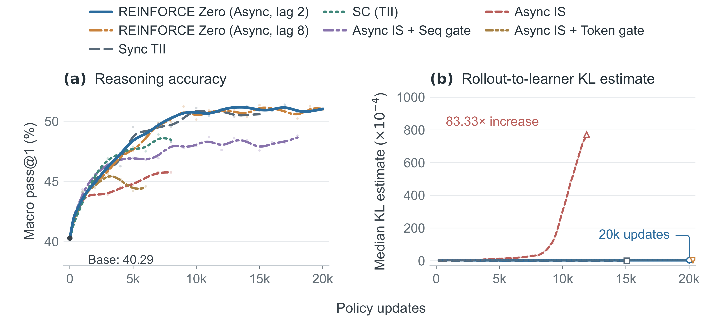
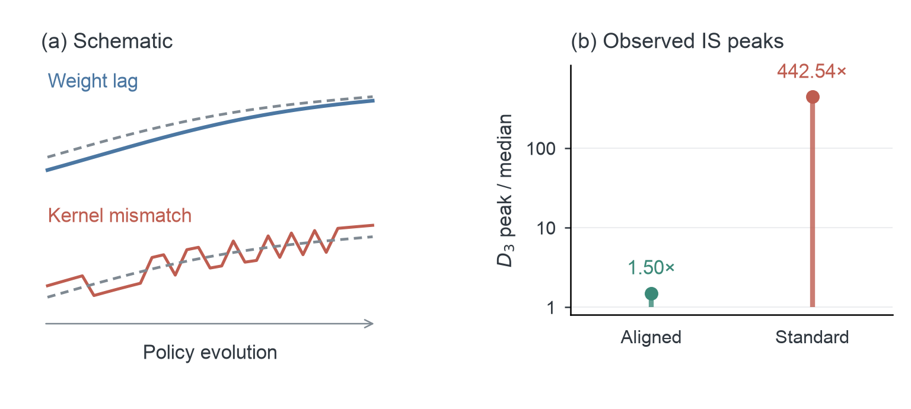

# REINFORCE Zero

### Kernel Alignment Unlocks Stable Asynchronous RL with Importance Sampling

[](https://hijkzzz.github.io/REINFORCE-Zero/)
[](https://www.alphaxiv.org/pdf/2611.reinforce-zero-kernel-alignment-asynchronous-rl)
[](https://www.researchgate.net/publication/417364950_REINFORCE_Zero_Kernel_Alignment_Unlocks_Stable_Asynchronous_RL_with_Importance_Sampling)
[](./skills/train-inference-consistency/SKILL.md)
[](https://github.com/NVIDIA-NeMo/labs-molt)
[](./REINFORCE-Zero.pdf)

**REINFORCE Zero enables stable asynchronous reinforcement learning with aligned kernels and unclipped token-level importance sampling.** Trainer–inference invariance (TII) removes numerical mismatch between rollout and learner execution; ordinary importance sampling corrects weight lag. The result is a simple recipe that sustains learning through **20,000 policy updates**, achieves **2.40× the training-step throughput** of synchronous training, and scales from mathematical reasoning to Python tools and visual computer use.

**In plain terms.** In asynchronous RL, the rollout engine and the learner disagree on token probabilities for two reasons. Rollouts use older weights (*weight lag*). The two systems also run different GPU kernels, the low-level routines behind matrix multiplication, attention, and normalization, whose floating-point results differ even at identical weights (*kernel mismatch*). TII aligns the kernels so that both systems return the same token probabilities; the importance ratio then corrects weight lag. The update is the PPO/GRPO surrogate with a group-mean baseline and an unclipped ratio. *Zero* denotes the absence of ratio clipping and sample-rejection gates.

**Authors:** Jian Hu, Hao Zhang, Yifan Zhang, Binfeng Xu, Ao Shen, Shaokun Zhang, Yunheng Zou, Yan Bai, Jan Kautz, Yi Dong

**Affiliations:** NVIDIA · Inferact

[Project page](https://hijkzzz.github.io/REINFORCE-Zero/) · [alphaXiv](https://www.alphaxiv.org/pdf/2611.reinforce-zero-kernel-alignment-asynchronous-rl) · [ResearchGate](https://www.researchgate.net/publication/417364950_REINFORCE_Zero_Kernel_Alignment_Unlocks_Stable_Asynchronous_RL_with_Importance_Sampling) · [Algorithm](./ALGORITHM.md) · [Agent skill](./skills/train-inference-consistency/SKILL.md) · [Molt](https://github.com/NVIDIA-NeMo/labs-molt) · [zero-mismatch-rl](https://github.com/Inferact/zero-mismatch-rl) · [Paper (PDF)](./REINFORCE-Zero.pdf)

## Kernel mismatch versus weight lag

**Kernel mismatch produces sharp, hard-to-control corrections. With kernels aligned, ordinary IS controls the smoother discrepancy from weight lag.** Figure 1 shows the difference: standard-kernel Async IS develops an **83.33× rise in rollout-to-learner KL**, while REINFORCE Zero keeps KL flat at policy lags **2 and 8**<sup>†</sup> through **20,000 updates** and continues improving reasoning quality.

[](https://hijkzzz.github.io/REINFORCE-Zero/)

*Figure 1 from the paper. Left: five-benchmark macro pass@1 with an 8K response budget. Right: sampled rollout-to-learner KL. TII removes kernel mismatch, leaving weight lag for ordinary IS to correct.*

*† “Lag 8” denotes the nominal pipeline setting. Measured rollout-to-learner policy lag averages approximately 10.5 learner updates, with long-response tails reaching 36–38 updates.*

The importance weights reveal why alignment matters. The diagnostic $D_3$ averages $w-1-\log w$ over the action tokens of an update; it is zero when every importance weight $w$ equals one and grows as the weights spread. Its peak-to-median ratio is **442.54 with standard kernels**, versus **1.50 with aligned kernels**. TII suppresses the correction spikes so IS can control the remaining weight lag.



*Figure 2 from the paper. Left: schematic weight lag and execution-dependent kernel mismatch. Right: observed peak-to-median ratio of $D_3$, on a logarithmic scale.*

## Align kernels. Correct lag. Keep learning.

Asynchronous training overlaps generation and optimization. Its policy gap has two sources: **older rollout weights** and **different numerical execution** in the rollout engine and learner.

REINFORCE Zero addresses each directly:

1. **Align execution with TII.** Batch-invariant kernels and matched forward computation produce matching token probabilities at identical weights and histories.
2. **Correct weight lag with token IS.** Use the actual behavior log-probabilities recorded during generation.
3. **Optimize a simple REINFORCE objective.** Combine group-mean advantages with per-response token averaging and unclipped importance ratios, without sample-rejection gates.

For responses to the same prompt, the advantage and loss are

```math
A_i=R_i-\frac{1}{G}\sum_{j\in\mathcal G(i)}R_j.
```

```math
\widehat{\mathcal L}(\theta)
=-\frac{1}{B}\sum_{i=1}^{B}\frac{1}{T_i}\sum_{t=1}^{T_i}
A_i\frac{\pi_\theta(a_{it}\mid h_{it})}{\mu_i(a_{it}\mid h_{it})}.
```

The learner differentiates through the numerator and averages over action tokens within each response, then over responses. See the [algorithm guide](./ALGORITHM.md) for the update and alignment workflow.

## Why TII unlocks importance sampling

**TII suppresses the numerical mismatch behind IS explosions, allowing unclipped IS to deliver its full correction.** IS restores the target mean update; alignment controls the update noise that can otherwise destabilize learning.

At a fixed token history, let $p_\theta$ be the target policy, $q$ the sampling policy, $A$ a fixed advantage function, and $s=\nabla_\theta\log p_\theta$. Since $\mathbb E_p[s]=0$, the target update is

```math
g^\star=\mathbb E_p[As]=\mathrm{Cov}_p(A,s).
```

The uncorrected update contains both a covariance term and score-mean drift:

```math
\mathbb E_q[As]
=\mathrm{Cov}_q(A,s)
+\underbrace{\mathbb E_q[A]\mathbb E_q[s]}_{\text{score-mean drift}}.
```

Score Centering removes the drift but retains the covariance under $q$. Unclipped IS, with $w=p_\theta/q$, corrects both:

```math
g_{\mathrm{SC}}=\mathbb E_q[A(s-\mathbb E_q[s])]=\mathrm{Cov}_q(A,s).
```

```math
\mathbb E_q[ws]=0.
```

```math
g_{\mathrm{IS}}=\mathbb E_q[wAs]=\mathrm{Cov}_p(A,s)=g^\star.
```

A correct mean alone does not ensure stable learning. The paper's Gaussian model shows the same step size producing bounded optimization error with matched sampling and growing error with mismatch—even as both mean parameters approach the optimum. TII and IS address these two parts together: **control the noise, preserve the full correction**. See the [full analysis and Figure 3](./ALGORITHM.md#tii-controls-the-instability-that-limits-is).

## Results

| Setting | Result |
| --- | --- |
| **20K-update reasoning** · DeepSeek-R1-Distill-Qwen-1.5B | Stable asynchronous training at policy lags **2 and 8**<sup>†</sup>, reaching **51.10% / 50.93%** five-benchmark macro pass@1 with an 8K response budget. |
| **Training throughput** · 16 GPUs, 12K updates | **2.40× Sync TII**: 68.55 vs. 164.77 training-step hours, with comparable reasoning quality. Timing excludes evaluation. |
| **High policy lag** · Qwen3-4B + Python | Learns at **lag 64** for **6,000 updates**; mean reward rises from **0.287 to 0.782**. |
| **MoE reasoning with tools** · Qwen3-30B-A3B + Python | Four-benchmark macro pass@1 rises from **31.29% to 71.55%** in 3,000 updates at a fixed 16K evaluation context. With a 32K context, macro pass@1 reaches **72.64%** and AIME25/26 mean pass@1 reaches **77.66%**. |
| **Visual computer use** · Nemotron-3-Nano-Omni-30B on OSWorld | Task-weighted pass@1 improves from **50.97% to 56.16%** after 428 updates: **+5.19 percentage points**. |

For the OSWorld workload with a **49K-token context and image inputs**, aligned execution increases mean end-to-end training-step time by only **6.8%** relative to the standard-kernel FlashREINFORCE baseline.

### Reasoning quality at 6,000 updates

DeepSeek-R1-Distill-Qwen-1.5B, 8K response budget. Pass@1 is the mean per-response accuracy; macro pass@1 gives equal weight to MATH500, AMC23, OlympiadBench, AIME25, and Minerva Math.

- **Sync TII** is the synchronous reference: it waits for all rollouts before each update and takes 2.40× the training-step time of REINFORCE Zero.
- **Async IS** baselines use standard kernels and token-level IS. The Seq gate and Token gate discard sequences or tokens whose rollout–learner divergence exceeds a threshold.
- **SC (TII)** uses Score Centering in place of IS.

| Recipe | TII | Asynchronous | Macro pass@1 |
| --- | :---: | :---: | ---: |
| Base model | — | — | 40.29% |
| Sync TII | ✓ | | 48.91% |
| Async IS | | ✓ | 45.32% |
| Async IS + Seq gate | | ✓ | 46.79% |
| Async IS + Token gate | | ✓ | 44.59% |
| SC (TII) | ✓ | ✓ | 47.50% |
| **REINFORCE Zero · lag 2** | ✓ | ✓ | **48.80%** |
| **REINFORCE Zero · lag 8**<sup>†</sup> | ✓ | ✓ | **48.53%** |

*† For the nominal lag-8 run, measured lag averages approximately 10.5 learner updates, with long-response tails reaching 36–38 updates.*

Both REINFORCE Zero runs continue improving through 20,000 updates, with flat rollout-to-learner KL and controlled gradient norms.

## Agent-driven kernel alignment

The [train-inference-consistency skill](./skills/train-inference-consistency/SKILL.md) from [NVIDIA-NeMo/labs-molt](https://github.com/NVIDIA-NeMo/labs-molt/tree/main/.agents/skills/train-inference-consistency) turns kernel alignment into a reusable development workflow:

- **Prepare:** map the model's operators, measure the baseline, and build a representative small proxy.
- **Align and validate:** match rollout and learner forward computation, then verify gradients and optimizer updates against an independent reference.
- **Scale and optimize:** bring the aligned path to the full model and recover throughput while repeating numerical checks.

The paper applies this workflow across attention, MoE, and Mamba hybrid architectures. This repository includes the complete skill and its supporting guides; the training implementation lives in [Molt](https://github.com/NVIDIA-NeMo/labs-molt).

[Inferact/zero-mismatch-rl](https://github.com/Inferact/zero-mismatch-rl) provides an agent-executable skill, model-specific recipes, and framework code for implementing TII: bitwise-identical token probabilities between vLLM rollout and Megatron-LM (mLite) / verl training.

## Citation

```bibtex
@article{hu2026reinforcezero,
  title   = {REINFORCE Zero: Kernel Alignment Unlocks Stable Asynchronous RL with Importance Sampling},
  author  = {Hu, Jian and Zhang, Hao and Zhang, Yifan and Xu, Binfeng and Shen, Ao and Zhang, Shaokun and Zou, Yunheng and Bai, Yan and Kautz, Jan and Dong, Yi},
  year    = {2026},
  url     = {https://github.com/hijkzzz/REINFORCE-Zero}
}
```
